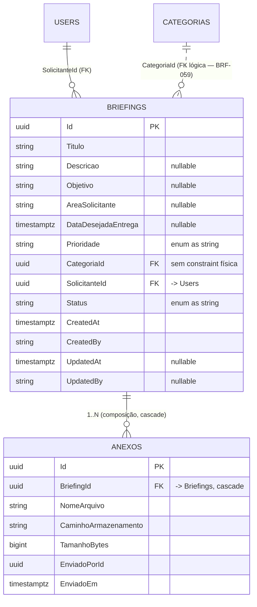

# Modelagem de Dados — Briefing e Anexo (BRF-001)

Cobre **RF004–RF010** do `requirements-doc.pdf`. Fatia de dados do Módulo de Briefings: agregado
`Briefing`, entidade filha `Anexo`, enums `Prioridade`/`StatusBriefing`, mapeamento EF Core e migration
`BriefingsAnexos`.

Espelha o formato de `docs/modelagem-usuarios-acesso.md`. **Migration gerada, não aplicada** — não há
Postgres acessível neste ambiente.

## ERD

## Dicionário de Dados

### Tabela `Briefings`

| Coluna | Tipo (PostgreSQL) | Nulo | Observações |
|---|---|---|---|
| `Id` | `uuid` | Não | PK |
| `Titulo` | `varchar(200)` | Não | Obrigatório desde a criação (RF005) |
| `Descricao` | `varchar(4000)` | Sim | Obrigatório no envio para aprovação (RF005/RF007) |
| `Objetivo` | `varchar(4000)` | Sim | Idem |
| `AreaSolicitante` | `varchar(200)` | Sim | Idem |
| `DataDesejadaEntrega` | `timestamptz` | Sim | Idem |
| `Prioridade` | `varchar(20)` | Não | Enum `Prioridade` como string |
| `CategoriaId` | `uuid` | Não | FK lógica → `Categorias` (RF040). Constraint física adiada para BRF-059 |
| `SolicitanteId` | `uuid` | Não | FK física → `Users` (`ON DELETE RESTRICT`), sem navegação |
| `Status` | `varchar(30)` | Não | Enum `StatusBriefing` como string |
| `OverdueSince` | `timestamptz` | Sim | **BRF-043.** Instante em que o monitor detectou o atraso (RF028); nulo enquanto no prazo. Limpo ao editar o briefing, preservado ao concluí-lo |
| `CreatedAt` | `timestamptz` | Não | Auditoria (interceptor) |
| `CreatedBy` | `varchar(100)` | Sim | Auditoria |
| `UpdatedAt` | `timestamptz` | Sim | Auditoria |
| `UpdatedBy` | `varchar(100)` | Sim | Auditoria |

**Índices:** `IX_Briefings_SolicitanteId`, `IX_Briefings_Status`, `IX_Briefings_CategoriaId`,
`IX_Briefings_OverdueSince` (BRF-043).

### Tabela `Anexos`

| Coluna | Tipo (PostgreSQL) | Nulo | Observações |
|---|---|---|---|
| `Id` | `uuid` | Não | PK |
| `BriefingId` | `uuid` | Não | FK física → `Briefings` (`ON DELETE CASCADE`) |
| `NomeArquivo` | `varchar(255)` | Não | |
| `CaminhoArmazenamento` | `varchar(1024)` | Não | Caminho abstrato (`IFileStorageService`, BRF-011) |
| `TamanhoBytes` | `bigint` | Não | `> 0` (invariante de domínio) |
| `EnviadoPorId` | `uuid` | Não | Autor do envio (RF052) |
| `EnviadoEm` | `timestamptz` | Não | Carimbado na criação |

**Índices:** `IX_Anexos_BriefingId`.

`Anexo` é **imutável** após criado (BRF-004): apenas setters privados; nova versão de arquivo gera um
novo registro, nunca uma edição. Não é auditável — carrega seu próprio `EnviadoEm`/`EnviadoPorId`.

## Enums

- `Prioridade` = `Baixa(1)`, `Media(2)`, `Alta(3)`, `Urgente(4)` — persistido como **string**.
- `StatusBriefing` = `Rascunho(1)`, `AguardandoAprovacao(2)`, `AjustesSolicitados(3)`, `Aprovado(4)`,
  `Rejeitado(5)`, `EmExecucao(6)`, `Concluido(7)`, `Cancelado(8)` — persistido como **string** (BRF-002).

## Máquina de estados (fatia BRF-001..004)

| Método | De | Para | Falha |
|---|---|---|---|
| `Criar` | — | `Rascunho` | `DomainException` (título/categoria/solicitante ausentes) |
| `Editar` (RF009) | `Rascunho`, `AguardandoAprovacao` | mesmo status | `DomainException` (outro status) |
| `EnviarParaAprovacao` (RF007) | `Rascunho`, `AjustesSolicitados` | `AguardandoAprovacao` | `Result` de validação (campos RF005 / anexo faltando); `DomainException` (status inválido) |
| `Cancelar` (RF010) | qualquer ≠ `EmExecucao`/`Concluido`/`Cancelado` | `Cancelado` | `DomainException` |
| `AdicionarAnexo` / `RemoverAnexo` | `Rascunho`, `AguardandoAprovacao`, `AjustesSolicitados` | — | `DomainException` (status não editável) |

Estados `Aprovado`/`Rejeitado`/`EmExecucao`/`Concluido` e a entrada em `AjustesSolicitados` são declarados
no enum, mas suas transições de entrada chegam com os módulos de Aprovação (BRF-015) e Tarefas.

## Decisões de projeto

- **`SalvarRascunho`** (lista de métodos de BRF-003) é realizado por `Criar` (salva o rascunho inicial) +
  `Editar` (edições posteriores do rascunho); um método separado duplicaria o caminho de `Editar`.
- **`CategoriaId`** fica como `uuid` + índice, **sem** FK física, até `Categorias` existir (BRF-059).
- **`SolicitanteId`** tem FK física para `Users` (tabela existente), **sem** propriedade de navegação —
  respeitando a fronteira de agregado.
- Transições de estado ilegais lançam `DomainException`; a validação de presença de campos de RF005 no
  envio retorna um `Result` de falha agregando todos os campos pendentes.

## Artefatos

| Artefato | Caminho |
|---|---|
| Enums | `src/BriefMe.Domain/Enums/{Prioridade,StatusBriefing}.cs` |
| Agregado | `src/BriefMe.Domain/Entities/Briefing.cs` |
| Entidade filha | `src/BriefMe.Domain/Entities/Anexo.cs` |
| Configs EF | `src/BriefMe.Infrastructure/Persistence/Configurations/{Briefing,Anexo}Configuration.cs` |
| DbContext | `src/BriefMe.Infrastructure/Persistence/AppDbContext.cs` (DbSets `Briefings`/`Anexos`) |
| Migration | `src/BriefMe.Infrastructure/Migrations/*_BriefingsAnexos.cs` |
| Testes | `tests/BriefMe.Domain.Tests/Entities/{Briefing,Anexo}Tests.cs` |
</content>
