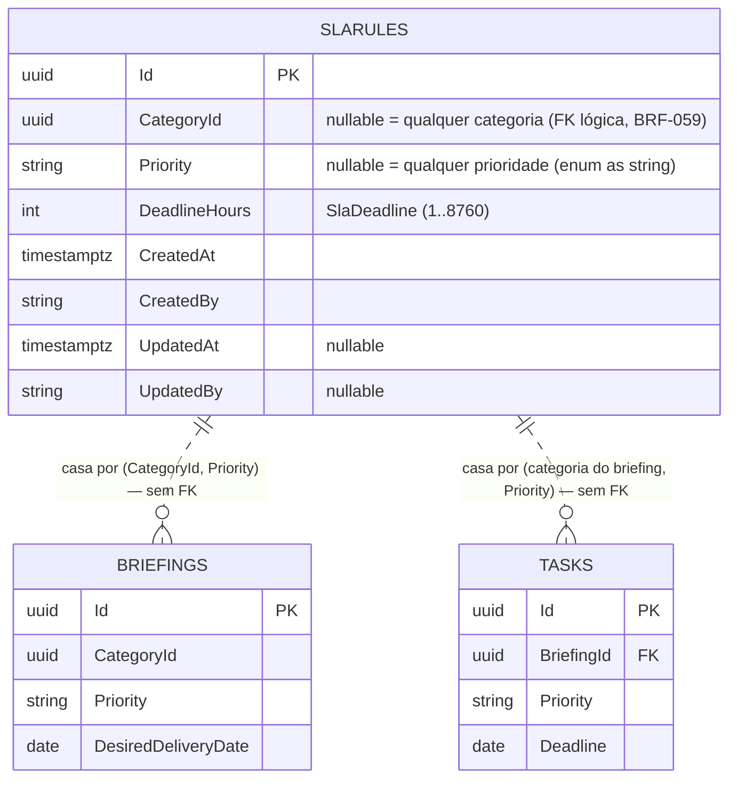

# Modelagem de Dados — Regra de SLA (BRF-040)

Cobre **RF027** do `requirements-doc.pdf` e prepara RF028–RF030 (monitoramento e identificação de atraso,
BRF-043–045). Fatia de dados do Módulo de SLA: agregado `SlaRule`, value object `SlaDeadline`, enum de
escopo `SlaRuleScope`, mapeamento EF Core e migration `SlaRules`.

Espelha o formato de `docs/modelagem-tarefas-comentarios.md`. **Migration gerada e aplicada** no Postgres de
desenvolvimento (`docker compose up -d db`).

## ERD



A linha pontilhada é literal: **não existe FK entre `SlaRules` e as demandas**, nos dois sentidos. Uma regra
não aponta para os briefings/tarefas que rege, e uma demanda não guarda a regra que a rege — se guardasse,
mudar o prazo padrão obrigaria a reescrever todas as linhas em aberto. A regra aplicável é resolvida na hora,
pelo job de BRF-043.

## Dicionário de Dados

### Tabela `SlaRules`

| Coluna | Tipo (PostgreSQL) | Nulo | Observações |
|---|---|---|---|
| `Id` | `uuid` | Não | PK |
| `CategoryId` | `uuid` | Sim | FK **lógica** → `Categories` (RF040). Nulo = a regra vale para qualquer categoria. A constraint física chega com BRF-059, como em `Briefings.CategoryId` |
| `Priority` | `varchar(20)` | Sim | Enum `Priority` como string (RF019). Nulo = a regra vale para qualquer prioridade |
| `DeadlineHours` | `integer` | Não | VO `SlaDeadline`, entre `SlaDeadline.MinHours` (1) e `SlaDeadline.MaxHours` (8760) |
| `CreatedAt` | `timestamptz` | Não | Auditoria (interceptor) |
| `CreatedBy` | `varchar(100)` | Sim | Auditoria |
| `UpdatedAt` | `timestamptz` | Sim | Auditoria |
| `UpdatedBy` | `varchar(100)` | Sim | Auditoria |

**Índices:** `UX_SlaRules_CategoryId_Priority` — **único** sobre `(CategoryId, Priority)`, com
`NULLS NOT DISTINCT`.

Sem `NULLS NOT DISTINCT` (PostgreSQL 15+; o compose roda 17) cada `NULL` conta como valor próprio e o índice
deixaria passar N regras globais — justamente as linhas que mais precisam ser únicas. Conferido no banco de
desenvolvimento: a segunda regra global é recusada com
`duplicate key value violates unique constraint "UX_SlaRules_CategoryId_Priority"`.

Nenhum índice adicional: a tabela é de configuração (unidades a dezenas de linhas) e o job de BRF-043 lê o
conjunto inteiro uma vez por passada. Busca por categoria já usa o prefixo do índice único.

## Escopos (RF027)

Duas colunas anuláveis produzem quatro escopos. `NULL` é curinga; a regra sem escopo algum é o padrão da casa.

| `CategoryId` | `Priority` | `Scope` | Ordem | Lê-se |
|---|---|---|---|---|
| preenchido | preenchida | `CategoryAndPriority` | 3 | "Vídeo urgente: 24h" |
| preenchido | `NULL` | `Category` | 2 | "Vídeo: 120h" |
| `NULL` | preenchida | `Priority` | 1 | "Qualquer coisa urgente: 48h" |
| `NULL` | `NULL` | `Global` | 0 | "O padrão da casa: 240h" |

`SlaRule.AppliesTo(categoria, prioridade)` devolve `true` quando cada lado **preenchido** do escopo bate com
o argumento correspondente. `SlaRule.Scope` classifica a regra na ordem acima.

A ordem é **total** — não há dois escopos distintos na mesma posição —, então "a mais específica entre as que
casam" é resposta única, e o índice único garante que também não existem duas regras concorrentes dentro do
mesmo escopo. Com isso, a resolução de BRF-043 é uma linha:

```csharp
var applicable = rules.Where(rule => rule.AppliesTo(categoryId, priority)).MaxBy(rule => rule.Scope);
```

Categoria acima de prioridade porque categoria é o tipo de trabalho ("vídeo demora mais que banner"),
configurado pelo setor de design, enquanto prioridade é urgência declarada pelo solicitante.

## Prazo (`SlaDeadline`)

| Membro | Comportamento |
|---|---|
| `Create(int) : Result<SlaDeadline>` | Falha esperada fora de `[1, 8760]` — consumível pelo validator de BRF-042 |
| `FromPersistedValue(int)` | Reidratação pelo conversor EF, como `Justification.FromPersistedValue` |
| `DueAtFrom(DateTime início)` | `início + Hours`. Puro: quem tem relógio é o chamador (BRF-043) |

Horas, não data: RF027 configura política ("quanto tempo"), e o vencimento só existe quando a política
encontra uma demanda com instante inicial. Horas **corridas** — RF027/RF028 não falam em expediente nem
feriado, e `BriefingTask.Deadline` já é data corrida. Calendário útil mudaria `DueAtFrom` e o job de BRF-043
juntos: é feature própria, não detalhe desta modelagem.

Teto de 8760h (365 dias): SLA é compromisso de prazo, não horizonte — o limite barra o zero digitado a mais
antes de ele virar uma regra que nunca vence.

## Divisão de validação

| Onde | O quê |
|---|---|
| `SlaDeadline.Create` → `Result` | Faixa de horas. VO é a fonte única da regra |
| `SlaRule.Create` → `DomainException` | Converte a falha do VO em exceção (critério de aceite do BRF-041: `DeadlineHours <= 0` lança) e recusa `Priority` fora do enum |
| Índice único no banco | Unicidade de escopo — o agregado não enxerga suas irmãs |

Mesmo par já usado em `Briefing.Reject` → `ParseJustification` → `Justification.Create`.
`Guid.Empty` em `categoryId` é normalizado para `null` (regra global) em vez de virar um escopo que não casa
com categoria alguma — mesmo tratamento que `BriefingTask.Create` dá a `designerId`.

## Decisões de projeto

- **Política, não trabalho.** `SlaRule` não referencia briefing nem tarefa, e nenhum dos dois guarda a regra
  que os rege. Congelar o vínculo obrigaria a reescrever demandas abertas a cada mudança de prazo.
- **`SlaRuleScope` é enum ordenado, não contagem de campos preenchidos.** Somar "tem categoria" + "tem
  prioridade" empataria `(categoria, NULL)` com `(NULL, prioridade)` em 1, e o vencedor dependeria da ordem
  de leitura do banco.
- **Regra sabe falar de si (`AppliesTo`, `Scope`); escolher entre regras é serviço de domínio** de BRF-043.
  Fazer a entidade enxergar as irmãs é o acoplamento que RF057 evita nas tarefas.
- **Sem `IsActive` e sem soft delete.** O backlog lista `Id`, `CategoryId`, `Priority`, `DeadlineHours` e
  auditoria. BRF-042 confirmou a ausência: a política tem um eixo só — quantas horas —, e reconfigurar o
  escopo cobre o RF027 inteiro, sem criar um estado "existe mas não vale".
- **Mutadores chegaram com BRF-042.** `ChangeDeadline(int)` altera o prazo e **não** o escopo: o par
  `(CategoryId, Priority)` é a identidade da regra, a mesma que o índice único protege. Reapontar o escopo
  seria escrever outra regra, não editar esta.
- **Repositório chegou com BRF-042.** `ISlaRuleRepository.GetByScopeAsync(categoryId?, priority?)` é busca
  por identidade — cada lado nulo casa literalmente com `NULL`. Escolher a regra que rege uma demanda
  (`AppliesTo` + `MaxBy(Scope)`) continua sendo trabalho de BRF-043.

## Pendência conhecida

`SlaRules.CategoryId` é FK lógica: a tabela `Categories` só existe a partir de BRF-059 — categorias ainda vêm
do `SeededCategoryRepository` em memória. Enquanto isso, uma regra pode apontar para uma categoria
inexistente e nada no banco reclama. BRF-059 adiciona a constraint física para `Briefings.CategoryId` e para
`SlaRules.CategoryId` na mesma migration. Até lá, quem segura a ponta é o caso de uso: o handler de BRF-042
recusa (`NotFound`) um `CategoryId` que não corresponda a categoria ativa, como já fazia `CreateBriefing`.

## Artefatos

| Artefato | Caminho |
|---|---|
| Value object | `src/BriefMe.Domain/ValueObjects/SlaDeadline.cs` |
| Enum de escopo | `src/BriefMe.Domain/Enums/SlaRuleScope.cs` |
| Agregado | `src/BriefMe.Domain/Entities/SlaRule.cs` |
| Config EF | `src/BriefMe.Infrastructure/Persistence/Configurations/SlaRuleConfiguration.cs` |
| DbContext | `src/BriefMe.Infrastructure/Persistence/AppDbContext.cs` (DbSet `SlaRules`) |
| Migration | `src/BriefMe.Infrastructure/Migrations/20260802223752_SlaRules.cs` |
| Repositório (BRF-042) | `src/BriefMe.Domain/Repositories/ISlaRuleRepository.cs`, `src/BriefMe.Infrastructure/Persistence/Repositories/SlaRuleRepository.cs` |
| Caso de uso (BRF-042) | `src/BriefMe.Application/UseCases/Sla/ConfigureSlaRule/` |
| Endpoint (BRF-042) | `PUT /sla-rules` — `src/BriefMe.Web/Controllers/SlaRulesController.cs` |
| Testes de domínio | `tests/BriefMe.Domain.Tests/ValueObjects/SlaDeadlineTests.cs`, `tests/BriefMe.Domain.Tests/Entities/SlaRuleTests.cs` |
| Teste de persistência | `tests/BriefMe.Infrastructure.Tests/Persistence/SlaRulePersistenceTests.cs` |
| Spec | `.specs/features/sla-modelagem/{spec,design,tasks}.md` |
