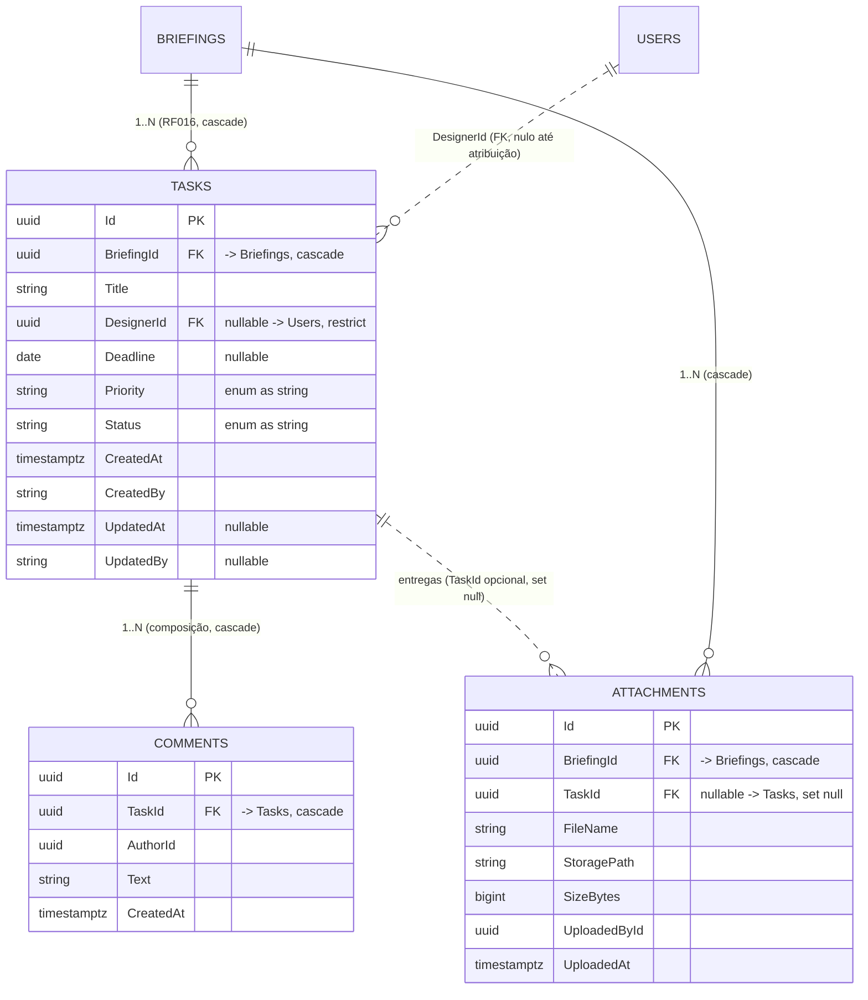

# Modelagem de Dados — Tarefa, Comentário e Entrega (BRF-021)

Cobre **RF015–RF022** (mais RF048 e RF057, que a máquina de estados já respeita) do `requirements-doc.pdf`.
Fatia de dados do Módulo de Tarefas: agregado `BriefingTask`, entidade filha `Comment`, enum
`BriefingTaskStatus`, vínculo de entregas em `Attachment`, mapeamento EF Core e migration `TasksComments`.

Espelha o formato de `docs/modelagem-briefings-anexos.md`. **Migration gerada e aplicada** no Postgres de
desenvolvimento (`docker compose up -d db`).

## ERD



## Dicionário de Dados

### Tabela `Tasks`

| Coluna | Tipo (PostgreSQL) | Nulo | Observações |
|---|---|---|---|
| `Id` | `uuid` | Não | PK |
| `BriefingId` | `uuid` | Não | FK física → `Briefings` (`ON DELETE CASCADE`), sem navegação (RF016) |
| `Title` | `varchar(200)` | Não | Obrigatório desde a criação (RF015) |
| `DesignerId` | `uuid` | Sim | FK física → `Users` (`ON DELETE RESTRICT`). Nulo até a atribuição (RF017, BRF-027) |
| `Deadline` | `date` | Sim | Nulo até o gestor definir o prazo (RF018, BRF-028) |
| `Priority` | `varchar(20)` | Não | Enum `Priority` como string (RF019) — o mesmo do briefing |
| `Status` | `varchar(30)` | Não | Enum `BriefingTaskStatus` como string (RF020) |
| `OverdueSince` | `timestamptz` | Sim | **BRF-043.** Instante em que o monitor detectou o atraso (RF028); nulo enquanto no prazo. Limpo ao replanejar prazo/prioridade, preservado após a aprovação |
| `CreatedAt` | `timestamptz` | Não | Auditoria (interceptor) |
| `CreatedBy` | `varchar(100)` | Sim | Auditoria |
| `UpdatedAt` | `timestamptz` | Sim | Auditoria |
| `UpdatedBy` | `varchar(100)` | Sim | Auditoria |

**Índices:** `IX_Tasks_BriefingId`, `IX_Tasks_DesignerId`, `IX_Tasks_Status`,
`IX_Tasks_OverdueSince` (BRF-043).

### Tabela `Comments`

| Coluna | Tipo (PostgreSQL) | Nulo | Observações |
|---|---|---|---|
| `Id` | `uuid` | Não | PK |
| `TaskId` | `uuid` | Não | FK física → `Tasks` (`ON DELETE CASCADE`) |
| `AuthorId` | `uuid` | Não | Quem comentou (RF021) |
| `Text` | `varchar(4000)` | Não | `Comment.MaxTextLength` |
| `CreatedAt` | `timestamptz` | Não | Carimbado na criação |

**Índices:** `IX_Comments_TaskId`.

`Comment` é **imutável** após criado (BRF-024): apenas setters privados; uma correção é um novo comentário,
nunca uma edição. Não é auditável — carrega seu próprio `CreatedAt`/`AuthorId`, como `Attachment`.

### Tabela `Attachments` (alteração)

| Coluna | Tipo (PostgreSQL) | Nulo | Observações |
|---|---|---|---|
| `TaskId` | `uuid` | Sim | **Nova.** FK física → `Tasks` (`ON DELETE SET NULL`). Nula em anexo de briefing (RF005), preenchida em entrega de tarefa (RF022) |

**Índice novo:** `IX_Attachments_TaskId`. As demais colunas seguem `docs/modelagem-briefings-anexos.md`.

Duas factories separam os dois tipos de linha:

| Factory | `TaskId` | Uso |
|---|---|---|
| `Attachment.Create` | `null` | Material de referência do briefing (RF005) |
| `Attachment.CreateDelivery` | preenchido | Arquivo produzido na execução da tarefa (RF022), com autor e data (RF052) |

## Enums

- `BriefingTaskStatus` = `NotStarted(1)`, `InProgress(2)`, `AwaitingTechnicalApproval(3)`,
  `AwaitingRequesterApproval(4)`, `Approved(5)`, `Rejected(6)`, `Blocked(7)` — os 7 status do RF020,
  persistido como **string**.
- `Priority` — reaproveitado do briefing (`Low/Medium/High/Urgent`), persistido como **string**.

## Máquina de estados (RF020)

`UpdateStatus(novoStatus)` consulta uma tabela estática de transições permitidas. Qualquer par ausente —
inclusive um status para ele mesmo — lança `DomainException`, e o status atual fica intocado.

| De | Para | Observação |
|---|---|---|
| — (`Create`) | `NotStarted` | Toda tarefa nasce não iniciada (RF015) |
| `NotStarted` | `InProgress`, `Blocked` | |
| `InProgress` | `AwaitingTechnicalApproval`, `Blocked` | Envio da entrega para aprovação técnica (RF042) |
| `AwaitingTechnicalApproval` | `AwaitingRequesterApproval`, `Rejected`, `Blocked` | Aprovação/reprovação técnica (RF043/RF044), encaminhamento ao solicitante (RF045) |
| `AwaitingRequesterApproval` | `Approved`, `Rejected`, `Blocked` | Aprovação final (RF046/RF047) |
| `Rejected` | `InProgress`, `Blocked` | Entrega reprovada volta ao Designer (RF048) |
| `Blocked` | `NotStarted`, `InProgress` | O estado anterior ao bloqueio não é memorizado |
| `Approved` | — | Terminal nesta fatia; a reabertura chega em RF025/BRF-037 |

A decisão lê **apenas** `this.Status`: nenhuma tarefa consulta as demais do briefing nem o próprio briefing
(RF057 — garantia reforçada por testes em BRF-083).

Caminho feliz do fluxo principal do sistema:

```
NotStarted ─▶ InProgress ─▶ AwaitingTechnicalApproval ─▶ AwaitingRequesterApproval ─▶ Approved
                  ▲                    │                            │
                  └────── Rejected ◀───┴────────────────────────────┘   (RF044/RF047 → RF048)
```

## Comportamento de exclusão

| FK | Comportamento | Razão |
|---|---|---|
| `Tasks.BriefingId → Briefings.Id` | `CASCADE` | Tarefa não existe fora do briefing (RF016) |
| `Comments.TaskId → Tasks.Id` | `CASCADE` | Composição dentro do agregado |
| `Tasks.DesignerId → Users.Id` | `RESTRICT` | Mesmo padrão de `Briefings.RequesterId`: usuário com tarefa não some |
| `Attachments.TaskId → Tasks.Id` | `SET NULL` | O arquivo pertence ao briefing; perder a tarefa não deve apagar a entrega |

Na prática briefings e tarefas não são excluídos (usam status, não soft delete) — as regras existem para
integridade referencial.

## Decisões de projeto

- **`BriefingTask`, não `Task`.** `System.Threading.Tasks.Task` e `System.Threading.Tasks.TaskStatus` estão em
  escopo por implicit usings em toda a solução; uma entidade `Task` exigiria diretiva de alias em todo arquivo
  que misturasse domínio e código assíncrono — ou seja, todos os handlers. O nome também enuncia a invariante
  do RF016. **As tabelas continuam `Tasks` e `Comments`**, como no backlog.
- **`Comment` é filha de `BriefingTask`**, não entidade independente: só existe no contexto da tarefa, entra
  por `AddComment` e sai por cascade.
- **`Attachment` continua pertencendo ao agregado `Briefing`**, com `TaskId` como coluna opcional.
  `BriefingTask` **não** expõe coleção de anexos — duas raízes possuindo a mesma entidade filha quebraria a
  fronteira de agregado. "Entregas desta tarefa" é consulta de repositório (BRF-025/BRF-031).
- **`UpdateStatus` genérico**, conforme BRF-023 ("valida a transição via uma tabela de estados permitidos").
  Os métodos nomeados de aprovação (`ApproveTechnically`, `RejectByRequester`, …) chegam em BRF-065, quando a
  justificativa obrigatória (RF044/RF047) fizer parte da assinatura.
- **Comentar é permitido em qualquer status**: RF021 fala em "os envolvidos", sem restrição — e é justamente
  numa tarefa bloqueada ou reprovada que o registro é mais necessário.
- **`Deadline` é `date`**, coerente com `Briefing.DesiredDeliveryDate`. Prazo de entrega é data de calendário;
  o job de SLA (BRF-043) compara com o fim do dia.
- Atribuição (RF017), prazo (RF018) e prioridade (RF019) só são definidos em `Create` nesta fatia; os
  mutadores chegam com seus casos de uso (BRF-027/BRF-028), como `Approve`/`Reject` chegaram em BRF-015 e não
  em BRF-003.

## Artefatos

| Artefato | Caminho |
|---|---|
| Enum | `src/BriefMe.Domain/Enums/BriefingTaskStatus.cs` |
| Agregado | `src/BriefMe.Domain/Entities/BriefingTask.cs` |
| Entidade filha | `src/BriefMe.Domain/Entities/Comment.cs` |
| Vínculo de entrega | `src/BriefMe.Domain/Entities/Attachment.cs` (`TaskId`, `CreateDelivery`) |
| Configs EF | `src/BriefMe.Infrastructure/Persistence/Configurations/{BriefingTask,Comment,Attachment}Configuration.cs` |
| DbContext | `src/BriefMe.Infrastructure/Persistence/AppDbContext.cs` (DbSets `Tasks`/`Comments`) |
| Migration | `src/BriefMe.Infrastructure/Migrations/20260727155645_TasksComments.cs` |
| Testes | `tests/BriefMe.Domain.Tests/Entities/{BriefingTask,Comment,Attachment}Tests.cs` |
| Spec | `.specs/features/tarefas-comentarios-modelagem/{spec,design,tasks}.md` |
