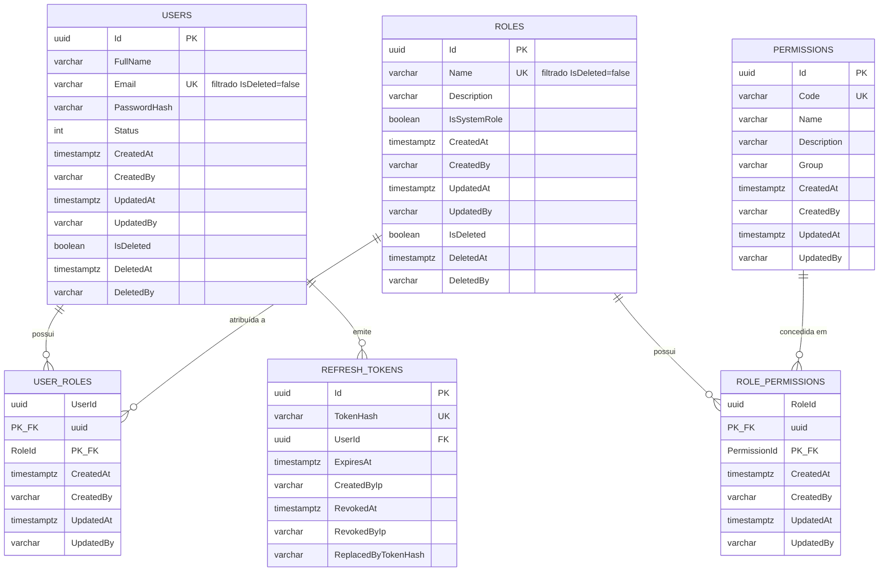

# Modelagem do Banco de Dados — Usuários e Acesso

Implementa USR-001 e USR-002 de `docs/backlog-usuarios-acesso.md`. Reflete exatamente o que foi
construído — ver `.specs/features/usuarios-acesso-modelagem/` para spec/design/tasks.

## ERD

## Dicionário de dados

### Users

| Coluna | Tipo | Obrigatório | Default | Descrição |
|---|---|---|---|---|
| Id | uuid | sim | — | PK |
| FullName | varchar(200) | sim | — | Nome completo |
| Email | varchar(256) | sim | — | VO `Email`, normalizado (lowercase/trim); único entre registros não deletados |
| PasswordHash | varchar(200) | sim | — | Hash BCrypt; nunca texto puro |
| Status | int | sim | — | Enum `UserStatus` (1=Active, 2=Inactive) |
| CreatedAt | timestamptz | sim | — | Preenchido pelo `AuditableEntitySaveChangesInterceptor` |
| CreatedBy | varchar(100) | não | null | Idem |
| UpdatedAt | timestamptz | não | null | Idem, em updates |
| UpdatedBy | varchar(100) | não | null | Idem |
| IsDeleted | boolean | sim | false | Soft delete |
| DeletedAt | timestamptz | não | null | Preenchido por `User.MarkAsDeleted` |
| DeletedBy | varchar(100) | não | null | Idem |

Índices: `IX_Users_Email` único, filtrado `"IsDeleted" = false`.

### Roles

| Coluna | Tipo | Obrigatório | Default | Descrição |
|---|---|---|---|---|
| Id | uuid | sim | — | PK |
| Name | varchar(100) | sim | — | Único entre registros não deletados |
| Description | varchar(500) | não | null | — |
| IsSystemRole | boolean | sim | false | Roles nativas não podem ser excluídas (`Role.MarkAsDeleted` lança `DomainException`) |
| CreatedAt/By, UpdatedAt/By | — | — | — | Auditoria automática |
| IsDeleted, DeletedAt, DeletedBy | — | — | — | Soft delete |

Índices: `IX_Roles_Name` único, filtrado `"IsDeleted" = false`.

### Permissions

| Coluna | Tipo | Obrigatório | Default | Descrição |
|---|---|---|---|---|
| Id | uuid | sim | — | PK |
| Code | varchar(150) | sim | — | Único; convenção `recurso.acao`; imutável após criação |
| Name | varchar(200) | sim | — | — |
| Description | varchar(500) | não | null | — |
| Group | varchar(100) | sim | — | Ex.: "Usuários", "Briefings" |
| CreatedAt/By, UpdatedAt/By | — | — | — | Auditoria automática |

Catálogo é imutável e não possui soft delete. Índices: `IX_Permissions_Code` único.

### UserRoles

| Coluna | Tipo | Obrigatório | Descrição |
|---|---|---|---|
| UserId | uuid | sim | PK composta + FK → `Users.Id` (cascade) |
| RoleId | uuid | sim | PK composta + FK → `Roles.Id` (cascade) |
| CreatedAt/By, UpdatedAt/By | — | — | Auditoria automática |

Criada apenas via `User.AssignRole` (fábrica `internal`); idempotente.

### RolePermissions

| Coluna | Tipo | Obrigatório | Descrição |
|---|---|---|---|
| RoleId | uuid | sim | PK composta + FK → `Roles.Id` (cascade) |
| PermissionId | uuid | sim | PK composta + FK → `Permissions.Id` (cascade) |
| CreatedAt/By, UpdatedAt/By | — | — | Auditoria automática |

Criada apenas via `Role.AddPermission` (fábrica `internal`); idempotente.

### RefreshTokens

| Coluna | Tipo | Obrigatório | Descrição |
|---|---|---|---|
| Id | uuid | sim | PK |
| TokenHash | varchar(200) | sim | Hash do token opaco; único |
| UserId | uuid | sim | FK → `Users.Id` (cascade) |
| ExpiresAt | timestamptz | sim | — |
| CreatedByIp | varchar(45) | não | — |
| RevokedAt | timestamptz | não | Preenchido por `RefreshToken.Revoke` |
| RevokedByIp | varchar(45) | não | — |
| ReplacedByTokenHash | varchar(200) | não | Aponta para o token de rotação |

`IsActive = !IsExpired && !IsRevoked` (computado, não persistido). Índices: `IX_RefreshTokens_Token`
único, `IX_RefreshTokens_UserId`.

## Implementação

| Item | Local |
|---|---|
| Abstrações base (`Entity`, `AggregateRoot`, `Result`, `DomainException`) | `src/BriefMe.Domain/Common/`, `src/BriefMe.Domain/Exceptions/` |
| `Email` (VO) | `src/BriefMe.Domain/ValueObjects/Email.cs` |
| Entidades | `src/BriefMe.Domain/Entities/` |
| `AppDbContext` + configurações EF | `src/BriefMe.Infrastructure/Persistence/` |
| `AuditableEntitySaveChangesInterceptor` | `src/BriefMe.Infrastructure/Persistence/Interceptors/` |
| `AddInfrastructure` (DI) | `src/BriefMe.Infrastructure/DependencyInjection.cs` |
| Migration inicial | `src/BriefMe.Infrastructure/Migrations/20260708002731_InitialUsersAccess.cs` |

**Nota**: a migration foi gerada e revisada, mas não aplicada — não há instância PostgreSQL
disponível neste ambiente (ver Out of Scope em `.specs/features/usuarios-acesso-modelagem/spec.md`).

**Aviso de validação do EF**: `Role` tem query filter de soft delete e é o lado obrigatório da
relação com `RolePermission`/`UserRole`; o `dotnet ef migrations add` emite um warning sobre
possível resultado inesperado se uma role for excluída enquanto ainda referenciada. Não bloqueia
a migration; fica registrado aqui para tratamento futuro (ex.: replicar o filtro nas tabelas de
junção) quando os casos de uso de exclusão de role forem implementados (USR-023, fora de escopo).

## Fora de escopo (ver spec.md)

Repositórios/UoW, CQRS/casos de uso, JWT/BCrypt/pipeline de auth, APIs, Blazor, seeds — seções 3–9
do backlog.
